<p align="center"><strong>▶ Live demo: <a href="https://helios-space-apps-2026.vercel.app">helios-space-apps-2026.vercel.app</a></strong></p>

<p align="center">
  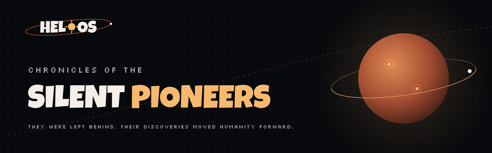
</p>

<p align="center"><em>They were left behind. Their discoveries moved humanity forward.</em></p>

<p align="center">
  
  
  
  
  
  
  
</p>

<p align="center">
  <https://helios-space-apps-2026.vercel.app/><strong>Live demo</strong>
  &nbsp;·&nbsp;
  <!-- TODO: demo video URL --><strong>Video</strong> (link coming)
  &nbsp;·&nbsp;
  <!-- TODO: Space Apps project page URL --><strong>Space Apps project page</strong> (link coming)
</p>

<p align="center">
  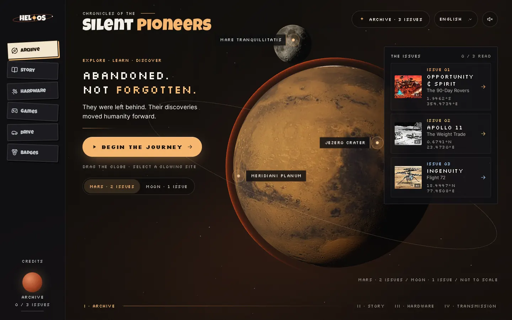
</p>

## Contents

- [The challenge](#the-challenge)
- [The three issues](#the-three-issues)
- [The experience: four states](#the-experience-four-states)
- [Features](#features)
- [Design system](#design-system)
- [Architecture](#architecture)
- [Getting started](#getting-started)
- [Adding a new mission](#adding-a-new-mission)
- [Performance and accessibility](#performance-and-accessibility)
- [Privacy](#privacy)
- [Data, credits and attribution](#data-credits-and-attribution)
- [Use of AI](#use-of-ai)
- [Roadmap](#roadmap)
- [Team Helios](#team-helios)
- [License](#license)

## The challenge

NASA Space Apps 2026 asks us to remember hardware that is **abandoned but not forgotten**. Rovers, landers and a helicopter still sit where they stopped, on Mars and the Moon.

We turned three of them into an interactive graphic novel for learners aged 10–16. Each issue tells the machine's story in comic panels backed by archival NASA photos, then puts the reader in front of a 3D diorama of the real hardware and a 15-second field test of the science it did.

## The three issues

| Issue | Hardware | Site | Coordinates | What you do |
|---|---|---|---|---|
| **01 · The 90-Day Rovers** | MER-A Spirit & MER-B Opportunity | Meridiani Planum, Mars | 1.9462° S, 354.4734° E | **Spectrometer Scan**: drive to the outcrop and deploy the arm on hematite "blueberries" |
| **02 · The Weight Trade** | Apollo 11 Lunar Module *Eagle*, descent stage | Mare Tranquillitatis, Moon | 0.6741° N, 23.473° E | **Laser Bounce**: carry the retroreflector, deploy it and catch the ≈2.5 s laser return |
| **03 · Flight 72** | Ingenuity Mars Helicopter | Jezero Crater, Mars | 18.4447° N, 77.4508° E | **RPM Throttle**: hold the rotors near 2,537 RPM through five waypoints and land gently |

Issue 01 follows both twins. Spirit's story (Gusev Crater, the locked right-front wheel, the silica find at Home Plate) and Opportunity's (Eagle and Endurance craters, the hematite) are kept apart and labeled in the app.

## The experience: four states

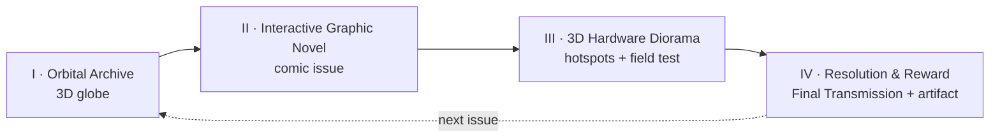

| | |
|---|---|
| 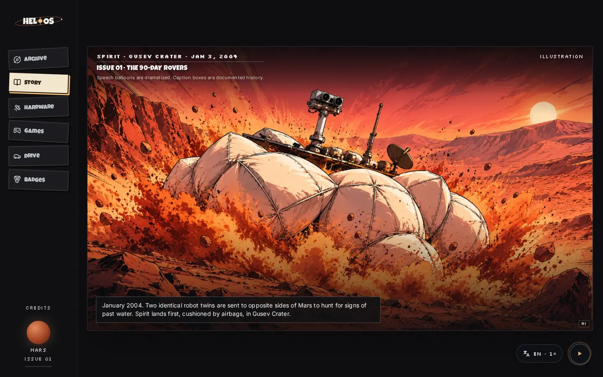 | 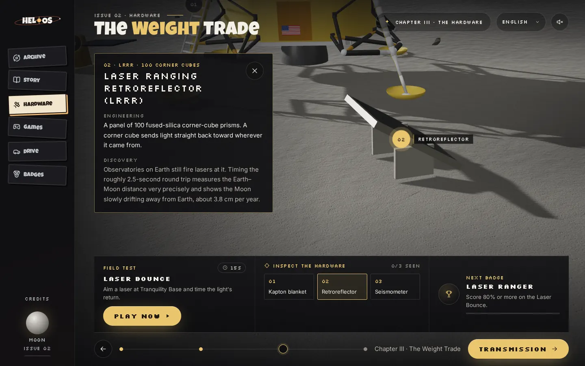 |
| **Story.** Comic panels with captions (history) and balloons (fictionalized narration). | **Hardware.** Orbit the diorama and open hotspots for engineering and science facts. |
| 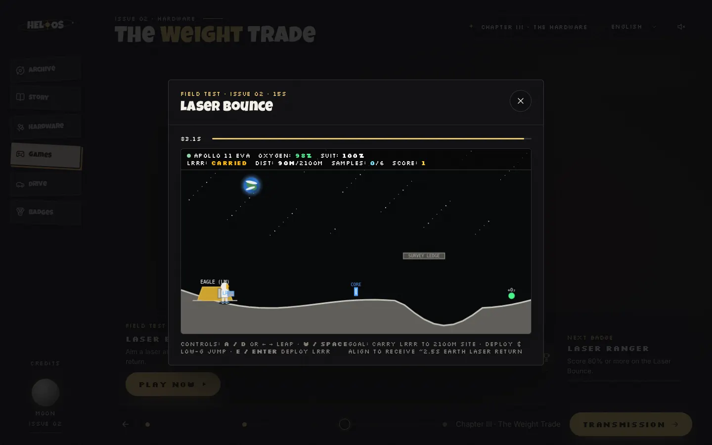 | 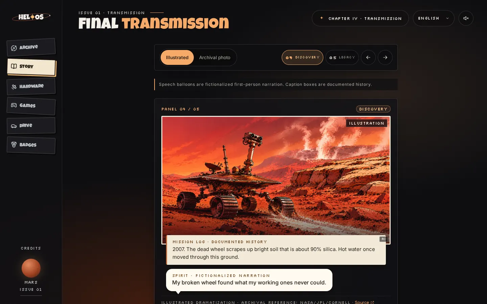 |
| **Field test.** A 15-second game built on the mission's science. | **Transmission.** Closing panels, the recovered artifact and a badge. |

## Features

**Storytelling**
- A scrolling motion comic for each issue, with irregular comic frames and the narrated line highlighted as it is read.
- Every image is labeled **ILLUSTRATION** or **ARCHIVAL · credit**, with archival photos linked to their source record.
- On the Final Transmission panels, an **Illustrated ↔ Archival photo** toggle swaps each panel for the matching NASA photo, with keyboard navigation (<kbd>←</kbd> <kbd>→</kbd> <kbd>Space</kbd> <kbd>PgUp</kbd> <kbd>PgDn</kbd>).
- NSSDC field archive for Issue 01, built from the official Spirit (MER-A) and Opportunity (MER-B) image catalogs.
- Read-aloud narration in English, Hindi, Spanish, French and Portuguese (Brazil), pre-rendered at build time as static MP3s. Visitors never trigger a runtime TTS call.

**3D**
- Orbital Archive: draggable Mars and Moon globes (also <kbd>←</kbd> <kbd>↑</kbd> <kbd>→</kbd> <kbd>↓</kbd>), glowing landing sites and an issue list.
- One diorama per mission, with art direction per body: warm haze and soft shadows on Mars, one hard sun and a black sky on the Moon.
- Three hotspots per machine, each with an engineering fact and a science discovery. The camera frames the selected part.
- A 3D artifact card on the reward screen.

**Games**
- Three 15-second field tests: Spectrometer Scan, Laser Bounce and RPM Throttle. Each plays with mouse, touch or keyboard, pauses while the tab is hidden, and opens with a briefing on the real science.
- **Signal Delay** (`/play/rover-drive`): plan a sol of rover commands, uplink them, and see what Mars did with them.

**Rewards**
- One artifact and one badge per issue (Spectral Eye, Laser Ranger, Thin-Air Pilot), plus First Contact, Hardware Inspector, Archivist and Patient Driver.
- Progress is saved on the device, so learners can come back later.

**Accessibility**
- Everything can be completed with the keyboard, and touch targets are at least 44 px.
- `prefers-reduced-motion` turns off camera tweens, idle drift and CSS animation.
- `?nowebgl` (or a device without WebGL) falls back to archival photos instead of 3D scenes.

**Performance**
- Screens, games and 3D viewers are lazy-loaded chunks.
- One live WebGL canvas per screen.
- Draco-compressed GLB models with WebP textures, decoded from a self-hosted decoder in `public/draco/`.

<details>
<summary>More screenshots</summary>

| Spectrometer Scan | RPM Throttle | Mobile (390 × 844) |
|---|---|---|
| 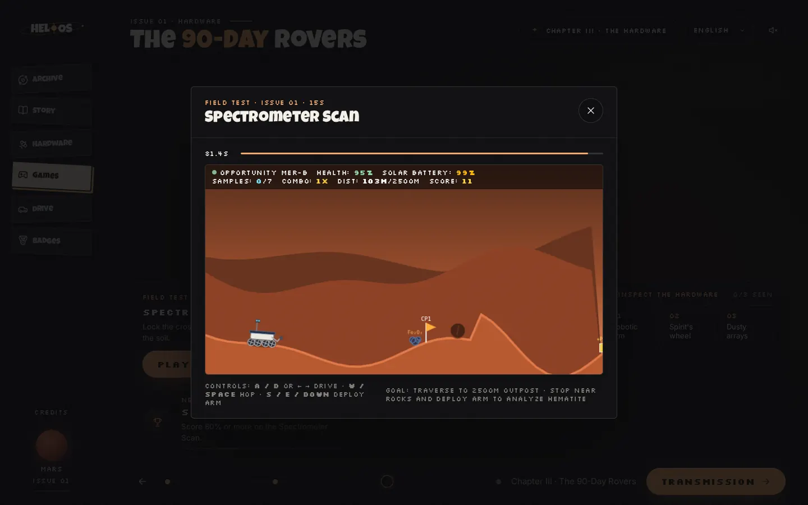 | 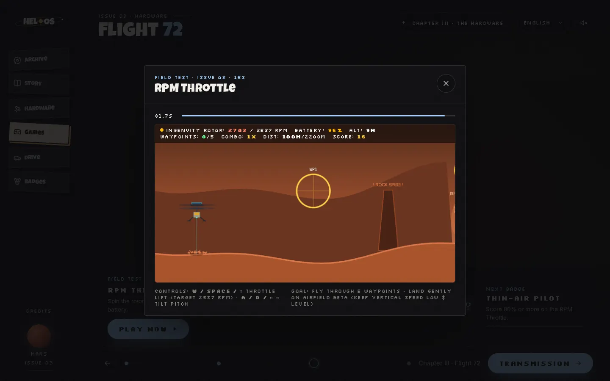 | 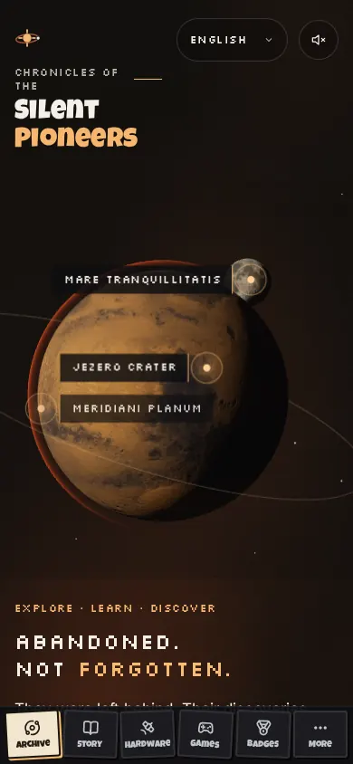 |

</details>

## Design system

**Direction:** NASA archival futurism × comic book.

| Token | Swatch | Use |
|---|---|---|
| Void |  | Background, space |
| Sun |  | Accent, actions, highlights |
| Rust |  | Mars, orbit lines |
| Paper |  | Primary text, comic paper |
| Regolith |  | Secondary text, the Moon |

| Font | Role |
|---|---|
| **Luckiest Guy** | Display: issue titles and the wordmark, comic-cover energy. |
| **Silkscreen** | UI: kickers, labels, telemetry and HUDs. A pixel face for the mission-control feel. |
| **Inter** | Body: captions, facts and long reading. |

Every duration and easing comes from `src/lib/motion.ts`.

## Architecture

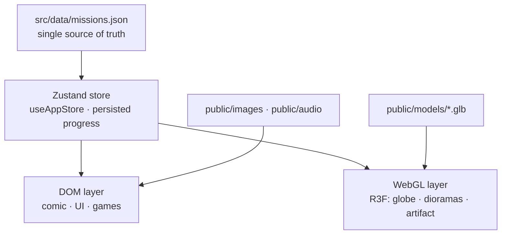

`src/App.tsx` routes on store state (`archive → story → hardware → reward`, plus `badges`). No mission copy is hard-coded in components.

<details>
<summary>Folder tree</summary>

```text
src/
  App.tsx              state router
  screens/             Archive, Story, Hardware, Reward, Badges
  components/
    comic/             reader, page, field archive, game modal, artifact card
    games/             field tests, Signal Delay, useGameLoop
    three/             OrbitalGlobe, HardwareViewer, Environment, AnchorProjector
    ui/                shell, loader, Helios marks, icons
  data/                missions.json, types.ts, locales/
  store/               useAppStore.ts (Zustand)
  narration/  i18n/  lib/
public/
  models/  images/  audio/  draco/  brand/
scripts/               comic generator, GLB inspector, narration, review tooling
```

</details>

<details>
<summary>Data contract (trimmed from <code>src/data/types.ts</code>)</summary>

```ts
export interface MissionData {
  id: string;
  issueNumber: number;
  issueTitle: string;
  title: string;
  hardwareName: string;
  celestialBody: 'mars' | 'moon';
  coordinates: { lat: number; lng: number; locationName: string };
  modelPath: string;
  scene: SceneConfig;
  telemetry: Telemetry;
  hotspots: HotspotData[];
  comicPanels: ComicPanel[];
  miniGame: MiniGame;
  artifact: Artifact;
  sources: Source[];
}

export interface HotspotData {
  id: string;
  position: [number, number, number];
  label: string;
  engineeringFact: string;
  scienceDiscovery: string;
  cameraPosition?: [number, number, number];
  attribution?: string;
}

export interface MiniGame {
  type: 'spectrometer_scan' | 'laser_bounce' | 'rpm_throttle';
  targetValue: string;
  durationSec?: number;
  successThreshold?: number;
  badgeThreshold?: number;
}
```

</details>

## Getting started

**Prerequisites:** Node.js 20.19+ or 22.12+ (required by Vite 8) and npm. <!-- TODO: pin the Node version in .nvmrc or package.json "engines" -->

```bash
npm install
npm run dev        # http://localhost:3000
npm run build      # type-check, then production build
npm run preview    # http://localhost:4173
```

| Script | Command | What it does |
|---|---|---|
| `dev` | `vite --host 0.0.0.0 --port 3000` | Dev server on port 3000, reachable on your LAN |
| `build` | `tsc -b && vite build` | Type-check, then build to `dist/` |
| `typecheck` | `tsc -b` | Type-check only |
| `lint` | `oxlint` | Lint |
| `preview` | `vite preview --port 4173` | Serve the production build |
| `narration:plan` | `tsx scripts/generate-narration.ts --plan` | Dry run: lines × languages, characters, estimated size |
| `narration:audition` | `tsx scripts/generate-narration.ts --audition` | One sample per speaker × language |
| `narration:generate` | `tsx scripts/generate-narration.ts --generate` | Generate all narration audio |
| `narration:verify` | `tsx scripts/generate-narration.ts --verify` | Check files, manifest, durations, clipping and loudness |
| `verify:no-secrets` | `tsx scripts/verify-no-secrets.ts` | Check the build for leaked keys |
| `review:capture` | `tsx scripts/review/capture.ts` | Playwright screenshots of every screen |
| `review:metrics` | `tsx scripts/review/metrics.ts` | FPS, draw calls and bundle metrics |
| `review:rover` | `tsx scripts/review/rover.ts` | Signal Delay Playwright E2E + perf sweep |

Running the app needs no environment variables. Only narration generation does: copy `.env.example` to `.env.local` and set `FISH_API_KEY` (used first) or `GEMINI_API_KEY`. These keys are server-side only and never shipped to the client. Useful URL flags: `?nowebgl`, `?fps` (frame/draw-call telemetry), `?quality=high|med|low` (lock 3D tier), `?stage=hardware&mission=apollo11&hotspot=lrrr`, `?issue=2`, `?mode=archival`.

## Adding a new mission

1. **Add an entry** to `src/data/missions.json` that matches `MissionData`: copy, telemetry, coordinates, `sources` and a credit and source link for every archival image.
2. **Drop in the model** at `public/models/<id>.glb`, Draco-compressed and under 3 MB. Check it with `npx tsx scripts/inspect-glb.ts public/models/<id>.glb`, then set `modelPath` and the `scene` camera and lighting.
3. **Add the comic panels** to `public/images/` and list them in `comicPanels`. AI-assisted art carries a `comicCredit` saying it is not NASA imagery.
4. **Define the hotspots**: a position on the model, a camera framing, an engineering fact and a science discovery.
5. **Pick or create a mini-game**: reuse one of the three `MiniGameType`s with new `params`, or add a component in `src/components/games/` on top of `useGameLoop`.

The globe, reader, diorama, reward screen and badges all pick up the new mission from the JSON.

## Performance and accessibility

Measured during our internal review (`review/TOP15.md`, desktop GPU, Playwright):

| Metric | Result |
|---|---|
| Hardware dioramas | ≈59–60 fps (Apollo 58.6, Opportunity 60.2, Ingenuity 60.2) |
| Archive globe | 60.4 fps |
| Apollo diorama draw calls | 177 → 45 after merging static meshes by material |
| First paint | 244 ms |
| Initial JS | ≈1.4 MB, of which three / R3F / drei is ≈1.0 MB (the first screen is the 3D globe) |

Lighthouse has not been run yet. Accessibility relies on full keyboard paths, focus-trapped dialogs, ≥44 px targets, reduced-motion support, labeled live regions for loaders, and the `?nowebgl` fallback.

## Privacy

- No accounts, sign-in, analytics or tracking scripts.
- Progress, badges and settings are saved only in the browser's `localStorage` (`helios-progress-v1`) and never leave the device.
- Narration audio is pre-generated and served as static files, so no text or voice data is sent anywhere at runtime.

## Data, credits and attribution

All mission facts and images are sourced in `src/data/missions.json`, and the in-app **Credits & sources** section lists every link.

| Issue | Archival imagery | Primary sources |
|---|---|---|
| 01 | NASA/JPL via NSSDC; NASA/JPL-Caltech; NASA/JPL/Cornell; NASA/JPL-Caltech/Cornell/ASU | [NSSDCA MER-A Spirit images](https://nssdc.gsfc.nasa.gov/planetary/mars/mars_exploration_rovers/mera_images.html) · [NSSDCA MER-B Opportunity images](https://nssdc.gsfc.nasa.gov/planetary/mars/mars_exploration_rovers/merb_images.html) |
| 02 | NASA | [NASA Image and Video Library](https://images.nasa.gov/) |
| 03 | NASA/JPL-Caltech; NASA/JPL-Caltech/MSSS | [NASA Image and Video Library](https://images.nasa.gov/) |

<details>
<summary>Every archival image</summary>

| Issue | Image | Credit | Source |
|---|---|---|---|
| 01 | Opportunity in Eagle Crater | NASA/JPL via NSSDC | [MER-B catalog](https://nssdc.gsfc.nasa.gov/planetary/mars/mars_exploration_rovers/merb_images.html) |
| 01 | Spirit's wheels in soft soil at Troy | NASA/JPL-Caltech | [PIA12007](https://images.nasa.gov/details/PIA12007) |
| 01 | Microscopic imager view of hematite spherules | NASA/JPL via NSSDC | [MER-B catalog](https://nssdc.gsfc.nasa.gov/planetary/mars/mars_exploration_rovers/merb_images.html) |
| 01 | Silica-rich soil churned up by Spirit's wheel | NASA/JPL/Cornell | [PIA09491](https://images.nasa.gov/details/PIA09491) |
| 01 | Opportunity's last 360° panorama | NASA/JPL-Caltech/Cornell/ASU | [PIA22908](https://images.nasa.gov/details/PIA22908) |
| 01 | Columbia Memorial Station, Gusev Crater | NASA/JPL via NSSDC | [MER-A catalog](https://nssdc.gsfc.nasa.gov/planetary/mars/mars_exploration_rovers/mera_images.html) |
| 01 | The rock "Adirondack" | NASA/JPL via NSSDC | [MER-A catalog](https://nssdc.gsfc.nasa.gov/planetary/mars/mars_exploration_rovers/mera_images.html) |
| 01 | Spirit's trench toward the Columbia Hills | NASA/JPL via NSSDC | [MER-A catalog](https://nssdc.gsfc.nasa.gov/planetary/mars/mars_exploration_rovers/mera_images.html) |
| 01 | Opportunity at the edge of Endurance crater | NASA/JPL via NSSDC | [MER-B catalog](https://nssdc.gsfc.nasa.gov/planetary/mars/mars_exploration_rovers/merb_images.html) |
| 02 | Saturn V launch of Apollo 11 | NASA | [6900556](https://images.nasa.gov/details/6900556) |
| 02 | Eagle in lunar orbit | NASA | [6900992](https://images.nasa.gov/details/6900992) |
| 02 | Aldrin beside the deployed seismometer | NASA | [AS11-40-5948](https://images.nasa.gov/details/as11-40-5948) |
| 02 | First sample return container unloaded | NASA | [S69-39996](https://images.nasa.gov/details/S69-39996) |
| 02 | The plaque on Eagle's descent-stage ladder | NASA | [AS11-40-5899](https://images.nasa.gov/details/as11-40-5899) |
| 03 | Ingenuity on Perseverance's belly | NASA/JPL-Caltech/MSSS | [PIA24424](https://images.nasa.gov/details/PIA24424) |
| 03 | Navcam view of the first flight | NASA/JPL-Caltech | [PIA24586](https://images.nasa.gov/details/PIA24586) |
| 03 | Perseverance selfie with Ingenuity | NASA/JPL-Caltech/MSSS | [PIA24542](https://images.nasa.gov/details/PIA24542) |
| 03 | "Castell Henllys", seen by Ingenuity | NASA/JPL-Caltech | [PIA25890](https://images.nasa.gov/details/PIA25890) |
| 03 | Ingenuity's shadow after Flight 72 | NASA/JPL-Caltech | [PIA26243](https://images.nasa.gov/details/PIA26243) |

</details>

- **3D models:** re-exported and art-directed by Team Helios. <!-- TODO: confirm and credit the original source of each GLB (apollo_lm, ingenuity, opportunity) -->
- **Comic art:** AI-assisted illustrations, labeled **ILLUSTRATION** in the app and never presented as NASA imagery. Some panels are procedural SVGs generated by `scripts/gen-comics.ts`.
- **Fonts:** Luckiest Guy, Silkscreen, Inter and Noto Sans Devanagari, all under the SIL Open Font License 1.1, via Fontsource.
- **Libraries:** React, Three.js, React Three Fiber, drei, Motion, Zustand, Tailwind CSS, Lucide and Vite, under their own open-source licenses.

> This project is not affiliated with or endorsed by NASA. NASA imagery is used under NASA's media usage guidelines and is credited per item.

## Use of AI

| Tool | Used for |
|---|---|
| **Google Gemini** (image generation) | Comic panel illustrations, generated from Team Helios prompts (`docs/ASSET_PROMPTS.md`), then art-directed, cropped and reviewed by the team. They are dramatizations, labeled **ILLUSTRATION** on the site. |
| **Anthropic Claude** (Claude Code) | Code assistance (application code, 3D scenes, games, review tooling), drafting captions and hotspot copy, and help with the factual review against NASA/JPL/NSSDC sources. |
| **Fish Audio** text-to-speech (`fish-s2.1-pro-free`; the pipeline can also use Google Gemini TTS) | Narration voices, pre-rendered at build time and credited in the app. |
| Machine-assisted translation | Hindi, Spanish, French and Portuguese (Brazil) UI and narration, under review. Names, numbers and hardware names are kept exactly as in the English source. |

The team checks every fact, caption and archival image against the NASA sources listed in `missions.json`.

## Roadmap

- [ ] Replace the low-poly Opportunity GLB (36 KB stand-in) with a detailed MER model and re-place its hotspots.
- [ ] Run Lighthouse (performance and accessibility) and publish the scores.
- [ ] Add a Parents & Teachers page covering learning goals, privacy and the use of AI.
- [ ] More issues: other machines that are abandoned but not forgotten.

## Team Helios

<p align="center">
  <picture>
    <source media="(prefers-color-scheme: dark)" srcset="public/brand/helios-wordmark.svg" />
    <source media="(prefers-color-scheme: light)" srcset="public/brand/helios-wordmark-dark.svg" />
    
  </picture>
</p>

| Name | Role | GitHub |
|---|---|---|
| <!-- TODO: team member --> *TBD* | *TBD* | *TBD* |

<!-- TODO: add every team member, their role and GitHub handle -->

## License

<!-- TODO: add a LICENSE file. Recommended: MIT for the code. -->
No license file has been added yet. We recommend **MIT** for the source code. NASA imagery follows [NASA's media usage guidelines](https://www.nasa.gov/nasa-brand-center/images-and-media/), and the AI-assisted illustrations and 3D models are not covered by the code license.

<br />

<p align="center">
  
  <br />
  <sub>Made for NASA Space Apps Challenge 2026 · Team Helios</sub>
</p>
